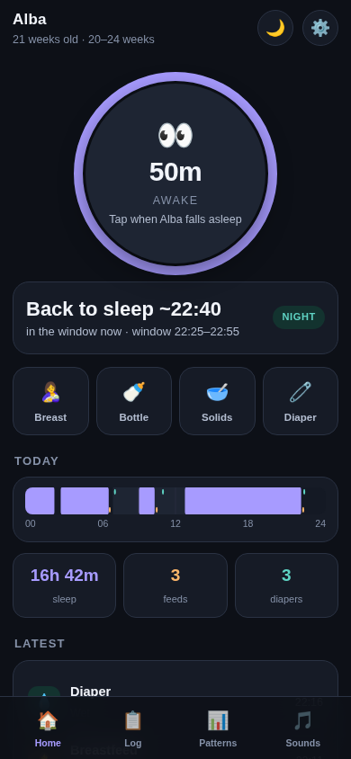
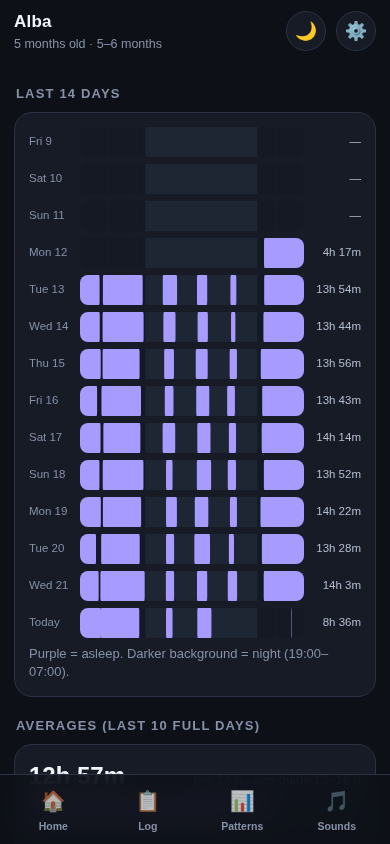
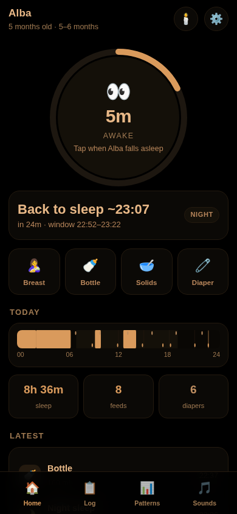

# Lull — baby sleep & feeding tracker

A one-tap tracker for a baby's sleep, feeds and diapers, with a sensible
prediction of the next nap. Built as an offline-first web app (PWA): it installs
to the home screen, works with no internet, and **keeps all data on the phone** —
nothing is uploaded anywhere.

Live: https://bordingcode.github.io/lull/

Modelled on the app *Luli*, with everything unlocked and no subscription.

<p align="center">
  
  
  
</p>

## Screens
- **Home** — giant sleep button (tap asleep / tap awake) with a progress ring,
  a live "awake for 1h 12m" counter, quick-log buttons for breast, bottle,
  solids and diaper, the next-nap prediction with a countdown, and today's
  24-hour bar.
- **Log** — every entry for a day, tap to correct the times, arrows to step back
  through previous days, and buttons to backfill anything you forgot.
- **Patterns** — one 24-hour bar per day for 14 days, averages against the
  age-appropriate sleep range, your baby's own measured awake window, and
  feeds/diapers per day. **Over time** charts total sleep (night vs naps,
  against the age guide), longest night stretch, feeds and diapers per day over
  2 weeks, a month, 3 months or everything (weekly averages past 45 days).
- **Growth** — weight, length and head circumference in kg/cm, plotted on the
  WHO Child Growth Standards (0–2 years, girls/boys) with the percentile in
  plain words.
- **Sounds** — white noise, brown noise, rain, heartbeat and a lullaby, all
  synthesised in the browser (no downloads, no loop seam), with volume and a
  fade-out sleep timer.
- **Settings** — name, birth date, girl/boy (for the growth curves), ml/oz, three colour schemes (dark, light and
  a dim warm **night mode** for 3am), reminders, and backup/restore.

## How the nap prediction works
1. Look up the age-typical awake window — a *range*, e.g. 2h–2h30 at 5 months.
2. Measure how long this baby has actually stayed awake recently (median of the
   last ~10 windows, nonsense gaps discarded).
3. Blend the two. More real data = more weight on the baby, capped at 70% so age
   always has a say.
4. Next sleep = last wake-up + the blended window, shown as a range plus a
   confidence label (Age-based → Learning → Learned).
5. The evening run-up to bedtime is treated as a longer window, as it is in real
   babies, and only once the day's naps are done.

Nothing is presented as more precise than it is, and the app says plainly that
these are consensus ranges, not medical advice.

## Honest limitations
- **Reminders** fire from a timer inside the page/service worker. They are
  reliable while Lull is open or installed to the home screen, but a web app
  cannot guarantee an alarm if the phone fully evicts it. The on-screen
  countdown is always correct.
- **One device.** Partner sync is not built yet, but every record carries an id
  and `updatedAt` plus deletion tombstones, so it can be added without a
  rewrite. Backup/restore moves data between phones today.

## Running and testing
```bash
python3 -m http.server 8777      # then open http://localhost:8777
node --test tests/               # prediction + stats unit tests
node tools/contrast.mjs          # WCAG contrast sweep, all three themes
```

## Deploying (gotcha)
Static GitHub Pages site with `.nojekyll`. After editing **any** shell file run:

```bash
./tools/bump.sh
```

It raises the version in one place everywhere it appears: `CACHE` in `sw.js`,
the `?v=` numbers in `index.html`, the service worker's file list, **and every
`import … from './x.js?v=N'` inside `js/`**. Two traps this closes:

- an unversioned `import` can be served stale from the browser's own HTTP cache
  (GitHub Pages sets a 10-minute max-age), producing an app that is half new and
  half old — the hardest kind of bug to see;
- the service worker's install now fetches with `cache: 'reload'`, so it can't
  re-cache a stale copy the browser handed it.

## Sources for the age guidance
See [docs/SOURCES.md](docs/SOURCES.md).
